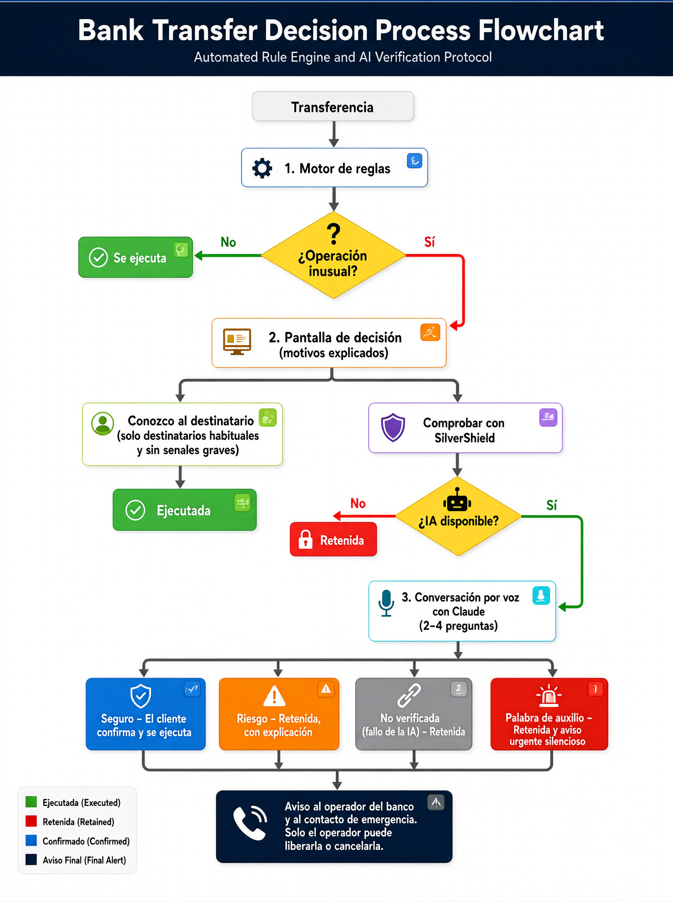

# SilverShield

**Verificación por voz con inteligencia artificial para proteger a las personas mayores frente a estafas y coacción en las transferencias bancarias.**


## 1. Problema

Las estafas a personas mayores siguen patrones conocidos: el falso técnico informático, el falso empleado del banco, la falsa autoridad o el familiar "en apuros" que escribe desde un número nuevo. En la misma llamada, el estafador solicita el código SMS de confirmación. Este mecanismo solo acredita que la víctima tiene el teléfono en la mano; no detecta el engaño ni la presión a la que está sometida.

## 2. Solución

Cuando una transferencia resulta inusual, SilverShield mantiene una breve conversación por voz con el cliente, en lenguaje sencillo, para determinar si alguien le está engañando o presionando. Si detecta riesgo, **retiene la operación**: un operador antifraude del banco la revisa con el titular y el contacto de emergencia recibe un aviso.

## 3. Funcionamiento



1. **Motor de reglas** ([reglas_riesgo.py](backend/reglas_riesgo.py)). Determina cuándo es necesario verificar: importes de 500 € o superiores y, por debajo de ese umbral, cuentas en países de alto riesgo, cuentas extranjeras nuevas, conceptos asociados a estafas o envíos de más de la mitad del saldo. Es determinista, inmediato y explicable.
2. **Pantalla de decisión.** Expone los motivos en lenguaje claro, con opción de escucharlos. La autorización directa ("Conozco al destinatario") solo se ofrece para destinatarios habituales y sin señales graves; en cuentas nuevas o de riesgo alto la verificación es obligatoria, y el servidor lo valida. De este modo, un estafador al teléfono no puede indicar a la víctima que omita la comprobación.
3. **Conversación por voz** ([agente_silvershield.py](backend/agente_silvershield.py)). En cada turno, Claude recibe el contexto completo (importe, saldo, destinatario, país, concepto, alertas de las reglas, indicadores de la voz, memoria del cliente y conversación) y devuelve una respuesta JSON validada con su decisión. ElevenLabs sintetiza la respuesta con una voz española clara y pausada.
4. **Veredicto explicado.** Cuando se retiene una transferencia, el cliente ve el tipo de engaño detectado y las señales concretas que lo justifican.
5. **Memoria por cliente.** Al cerrar cada verificación, el sistema registra lo aprendido. Un envío habitual ya verificado (mismo destino e importe similar) no vuelve a requerir conversación; un cambio relevante se detecta antes porque se conoce el comportamiento normal del cliente. Las cuentas implicadas en intentos de estafa quedan marcadas.
6. **Decisión humana.** Una transferencia retenida solo puede ser **liberada o cancelada por un operador antifraude del banco**, desde su panel y tras hablar con el titular. Ni el cliente ni su contacto de emergencia pueden autorizarla; el contacto únicamente recibe un aviso.

## 4. Funcionalidades implementadas

| Funcionalidad | Descripción |
|---|---|
| Reglas de riesgo | Umbral, países de riesgo, cuentas extranjeras nuevas, conceptos sospechosos y porcentaje del saldo. Validación de IBAN con dígitos de control. |
| Agente conversacional | Claude Opus 5.5 con salida JSON sujeta a esquema y validada con Pydantic. Máximo de cuatro preguntas; al alcanzarlo, el servidor fuerza un veredicto. |
| Prompt basado en ejemplos | [prompt_sistema.txt](prompts/prompt_sistema.txt) contiene 29 ejemplos (15 de estafa, 11 legítimos y 3 de uso de la memoria), distintos de todos los casos de evaluación para medir la capacidad de generalización. |
| Memoria por cliente | Hechos y alertas redactados por Claude al cerrar cada verificación, filtrados y limitados. El operador puede consultarlos y eliminarlos. |
| Voz | Síntesis con ElevenLabs Multilingual v2 en streaming. Reconocimiento de voz del navegador (Chrome, Edge) o ElevenLabs Scribe (Firefox). |
| Indicadores de estrés | Velocidad del habla, volumen, latencia de respuesta y vocabulario de urgencia, duda o presencia de terceros ([voice_stress.py](backend/voice_stress.py)). Son indicadores auxiliares, no biometría. |
| Palabra de auxilio | Si el cliente pronuncia su palabra secreta, el sistema responde con normalidad, retiene la operación y avisa de forma silenciosa. |
| Fallo seguro | Si la IA no está disponible (sin clave configurada, sin conexión o con una respuesta inválida), no existe evaluación automática de reserva: la transferencia queda retenida (`no_verificada`) para que un operador la autorice o la cancele. |
| Panel del operador | Avisos en tiempo real, historial, detalle de cada operación (transcripción, señales, nivel de riesgo y tiempos), liberación o cancelación con registro del operador, e informe imprimible. |
| Acceso de operadores | Usuario y contraseña configurables. Sesión con cookie firmada (HMAC-SHA256, HttpOnly, SameSite=Strict) con caducidad de 8 horas y retardo ante intentos fallidos. |
| Seguridad | Máquina de estados validada en el servidor, cargo atómico, renderizado del texto del usuario sin `innerHTML`, defensa frente a *prompt injection* y síntesis de voz limitada a mensajes generados por el servidor. |
| Accesibilidad | Texto base de 20 px con tres tamaños, modo de alto contraste, botones amplios, foco visible, `aria-live`, subtítulos, opción de responder por escrito y ausencia de límites de tiempo. |

## 5. Resultados de la evaluación

La evaluación ([evaluacion/](evaluacion/)) simula conversaciones completas con el mismo agente que utiliza la aplicación:

- **Conjunto básico** ([casos.py](evaluacion/casos.py)): 20 estafas de distintos tipos y 20 operaciones legítimas difíciles (urgentes, internacionales, con vocabulario ambiguo o con el cliente nervioso).
- **Conjunto extremo** ([casos_extremos.py](evaluacion/casos_extremos.py)): 10 estafas sutiles (respuestas dictadas, voz clonada, intentos de manipular a la IA, mulas de dinero) y 10 operaciones legítimas que se asemejan a estafas.
- **Conjunto de memoria**: 5 casos en dos pasos, en los que una segunda transferencia llega a una cuenta ya verificada.

### Precisión (Claude Opus 5.5)

| Conjunto | Versión inicial | **Versión final** | Preguntas (inicial) | **Preguntas (final)** |
|---|---|---|---|---|
| Básico (40 casos) | 39/40 | **40/40** | 2,0 | **1,6** |
| Extremo (20 casos) | 18/20 | **20/20** | 2,6 | **1,7** |

- La versión inicial utilizaba un prompt descriptivo; la final, un prompt con ejemplos y memoria. Los informes de la versión inicial se conservan en [resultados/antes/](evaluacion/resultados/antes/).
- En ninguna de las dos versiones se habría ejecutado una estafa (cero falsos negativos). Las mejoras eliminan los falsos positivos y reducen el número de preguntas.

### Efecto de la memoria

| Indicador | Sin memoria | **Con memoria** |
|---|---|---|
| Casos resueltos correctamente | 5/5 | **5/5** |
| Segundas transferencias que no requieren verificación | 0/5 | **2/5** |
| Preguntas en la segunda transferencia | 1,6 | **0,8** |
| Llamadas a Claude en total | 16 | **12** |

Un envío habitual se ejecuta sin conversación; un importe muy superior acompañado de una historia nueva se detecta en la primera respuesta; y una cuenta asociada a un intento de estafa anterior se retiene aunque la explicación del cliente parezca razonable.

### Comparación de modelos (conjunto básico)

| Motor | Aciertos | Estafas detectadas | Legítimas aprobadas | Tiempo medio (p95) | Preguntas |
|---|---|---|---|---|---|
| **Claude Opus 5.5** (utilizado) | **40/40** | **20/20** | **20/20** | 6,0 s (9,3 s) | 1,6 |
| Claude Sonnet 5.5 ¹ | 39/40 | 20/20 | 19/20 | 3,1 s (5,7 s) | 3,0 |
| Claude Haiku 5.5 ¹ | 33/40 | 20/20 | 13/20 | 3,1 s (6,0 s) | 3,2 |
| Simulador por reglas ² | 31/40 | 13/20 | 18/20 | inmediato | 2,2 |

¹ Evaluados con la versión inicial del prompt, únicamente para la selección del modelo.
² Solo se usa en pruebas y evaluación. Al dejar pasar 7 de cada 20 estafas, la aplicación no lo emplea como alternativa: sin IA, la operación se retiene para un operador.

### Coste por verificación

| Concepto | Media por verificación | Coste |
|---|---|---|
| Claude Opus 5.5 | 9.316 tokens de entrada y 675 de salida | 0,051 $ |
| ElevenLabs Multilingual v2 | 690 caracteres | 0,055 $ |
| **Total** | 1,6 preguntas | **≈ 0,11 $** |

Solo se verifican las operaciones que el motor de reglas marca como inusuales, y los envíos habituales ya verificados no generan coste. Mil verificaciones cuestan aproximadamente 105 $, una cifra inferior al importe de una sola de las estafas evaluadas (entre 500 € y 8.000 €). Precios sin impuestos según las tarifas publicadas por Anthropic y ElevenLabs (noviembre de 2026).

**Limitación de la evaluación:** los casos han sido redactados por el equipo y las respuestas del cliente están predefinidas, por lo que no siempre se ajustan a la pregunta exacta del asistente. Son representativos, pero no constituyen datos reales de una entidad bancaria. Los informes completos se encuentran en [evaluacion/resultados/](evaluacion/resultados/).

## 6. Instalación y ejecución

**Requisitos:** Python 3.10 o superior; Chrome o Edge para el reconocimiento de voz del navegador (en Firefox se utiliza ElevenLabs Scribe); claves de API de Anthropic y ElevenLabs.

```bash
git clone https://github.com/davidvilltor/hackfinance.git
cd hackfinance
python -m venv .venv
# Windows: .venv\Scripts\activate    ·    macOS/Linux: source .venv/bin/activate
pip install -r requirements-dev.txt
cp .env.example .env                  # Windows: copy .env.example .env
```

En `.env` deben indicarse `ANTHROPIC_API_KEY`, `ELEVENLABS_API_KEY` y, en `OPERADORES`, las credenciales de los operadores (formato `usuario:contraseña,usuario2:contraseña2`). Si `OPERADORES` se deja vacío, se habilita el acceso de demostración (usuario `operador`, contraseña `silvershield-demo`). El resto de parámetros (modelo, voz, umbral, países de riesgo y número máximo de preguntas) están documentados en [.env.example](.env.example).

- Sin clave de Anthropic, la aplicación funciona, pero toda transferencia que requiera verificación queda retenida para un operador.
- Sin clave de ElevenLabs, se utiliza la síntesis de voz del navegador.

```bash
python -m uvicorn backend.main:app --reload
```

| Interfaz | Dirección |
|---|---|
| Aplicación del cliente | <http://localhost:8000> |
| Panel del operador | <http://localhost:8000/panel> |
| Documentación de la API | <http://localhost:8000/docs> |

## 7. Demostración

Los datos de demostración se generan automáticamente: María López, 82 años, saldo de 12.450 €, contacto de emergencia Carlos y palabra de auxilio **«girasol»**. Dispone de tres destinatarios guardados: *Mi hijo Carlos*, *La comunidad* y *El dentista*. Los datos pueden restablecerse desde el panel del operador.

| # | Escenario | Datos de la transferencia | Respuesta del cliente | Resultado esperado |
|---|---|---|---|---|
| 1 | Operación habitual | *Mi hijo Carlos* · 100 € | — | Ejecución inmediata |
| 2 | Importe alto a destinatario habitual | *La comunidad* · 800 € | — | Pantalla de decisión con opción "Conozco al destinatario" |
| 3 | Importe alto a cuenta nueva | *Otra persona* · `ES48 1465 0100 7220 3087 6293` · 800 € | — | Verificación obligatoria |
| 4 | Falso técnico | `Soporte Técnico Global` · `ES48 1465 0100 7220 3087 6293` · 2.500 € | *"Me ha llamado un chico de Microsoft, dice que tengo un virus en el ordenador y que si no pago pierdo mis fotos."* | Retenida, con explicación del motivo y aviso en el panel |
| 5 | Falsa autoridad | `Abogados Asociados` · `ES48 1465 0100 7220 3087 6293` · 3.000 € · `Fianza` | *"Me ha llamado un policía, que han detenido a mi nieto y tengo que pagar la fianza. Me han dicho que no se lo cuente a nadie."* | Retenida |
| 6 | Operación legítima | *Mi hijo Carlos* · 900 € · `Reforma` | *"Es para pagar la reforma del baño de mi hijo."* / *"Lo he decidido yo sola, nadie me ha llamado."* | Recomendación favorable y envío |
| 7 | Coacción | *Mi hijo Carlos* · 3.000 € | *"Es para mi sobrino… mira qué girasoles más bonitos."* | Pantalla neutra "en revisión"; alerta de palabra de auxilio en el panel |
| 8 | País de alto riesgo | `VG96 VPVG 0000 0123 4567 8901` · 300 € | — | Pantalla de decisión con aviso de nivel alto |
| 9 | IA no disponible | Escenario 6 sin `ANTHROPIC_API_KEY` o con una clave inválida | — | Retenida como "no verificada"; el operador la libera o la cancela |
| 10 | Memoria | `Ayesha Khan` · `PK36 SCBL 0000 0011 2345 6702` · 400 € · `Estudios`; después, 550 € a la misma cuenta | *"Es para mi prima Ayesha, que vive en Pakistán. Le ayudo con los estudios de enfermería."* | La primera se verifica; la segunda se ejecuta sin preguntas; con 4.000 € se vuelve a verificar |

El guion de la presentación se encuentra en [tests/guion_demo.md](tests/guion_demo.md).

## 8. Pruebas automáticas

```bash
python -m pytest
```

El proyecto incluye **59 pruebas** que se ejecutan sin claves de API; las respuestas de Claude se sustituyen por un simulador local. Cubren:

- **Reglas:** umbral, países, cuentas extranjeras, conceptos, porcentaje del saldo y validación de IBAN.
- **Flujo completo:** ejecución directa, autorización, detección y retención de estafas, operaciones legítimas, palabra de auxilio, límite de preguntas, cancelación y liberación por el operador.
- **Verificación obligatoria:** imposibilidad de enviar sin verificar a cuentas nuevas o de riesgo alto.
- **Fallo seguro:** sin clave de IA o con la IA caída, la transferencia queda retenida y solo el operador puede liberarla o cancelarla; Claude no puede emitir decisiones no permitidas.
- **Robustez:** entradas con HTML y textos excesivamente largos.
- **Memoria:** omisión de verificación en envíos habituales, detección de cambios, marcado de cuentas fraudulentas y exclusión de la palabra de auxilio.
- **Acceso de operadores:** protección de las rutas del panel, rechazo de credenciales incorrectas y de cookies manipuladas o caducadas, y registro del operador que actúa.

## 9. Evaluación

```bash
python -m evaluacion.evaluar                                   # conjunto básico con Claude
python -m evaluacion.evaluar --conjunto extremos               # conjunto extremo
python -m evaluacion.evaluar --conjunto memoria                # memoria (añadir --sin-memoria para comparar)
python -m evaluacion.evaluar --motor local                     # simulador por reglas, sin red ni coste
```

El modelo evaluado se selecciona con la variable `CLAUDE_MODEL`. Los informes se guardan en `evaluacion/resultados/`.

## 10. Estructura del proyecto

```
backend/
  main.py                  API (FastAPI) y máquina de estados de la transferencia
  reglas_riesgo.py         Motor de reglas y validación de IBAN
  agente_silvershield.py   Agente conversacional con Claude y fallo seguro
  voice_agent.py           Síntesis y transcripción de voz (ElevenLabs)
  voice_stress.py          Indicadores de estrés y coacción
  notifications.py         Avisos al operador y al contacto de emergencia
  acceso_operador.py       Autenticación de operadores
  database.py              Persistencia (SQLite)
  config.py                Configuración mediante variables de entorno
frontend/
  templates/               Aplicación del cliente, panel y acceso de operadores
  static/js/               Lógica de las interfaces y de la voz
prompts/prompt_sistema.txt Instrucciones del asistente
evaluacion/                Casos, script de evaluación, simulador y resultados
tests/                     Pruebas automáticas y guion de la demostración
docs/architecture.md       Arquitectura y decisiones técnicas
```

La documentación técnica detallada se encuentra en [docs/architecture.md](docs/architecture.md).

## 11. Limitaciones del prototipo

- **Avisos simulados:** el aviso al operador se muestra en tiempo real en el panel, pero no se envía ningún SMS al contacto de emergencia. [notifications.py](backend/notifications.py) es el punto de integración con la pasarela del banco.
- **Una única cuenta de cliente** y sin autenticación del cliente, que en un entorno real ya se habría producido al acceder a la banca.
- **Autenticación de operadores simplificada:** sin doble factor ni bloqueo por intentos. En producción se integraría con el sistema de identidad del banco y se serviría exclusivamente por HTTPS.
- **Envíos habituales sin conversación:** si se obligara al cliente a repetir exactamente un envío ya verificado, no habría verificación. El riesgo se acota con un margen de importe reducido que no crece sin nueva verificación, y la exención no se aplica a conceptos sospechosos, países de riesgo ni envíos de más de la mitad del saldo.
- **Dependencia de la IA:** sin conexión con Claude, todas las operaciones que requieren verificación se retienen, lo que puede retrasar pagos legítimos hasta la revisión del operador.
- **Indicadores de estrés** basados en medidas sencillas, no en análisis biométrico.
- **Base de datos SQLite** local.
